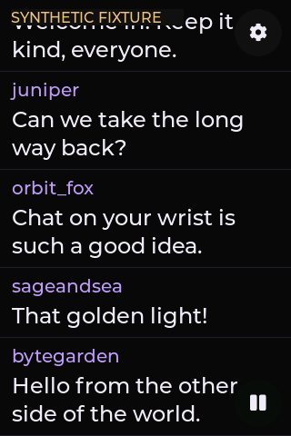

# Forearm Chat

A native, standalone Twitch chat reader for the Guition JC3248W535 family: ESP32-S3, 3.5-inch 320 × 480 IPS capacitive touch, 16 MB flash and 8 MB PSRAM. It operates directly over Wi-Fi or a phone hotspot. A computer provides development and initial USB setup; normal chat reception runs on the device.

**Hardware beta — 0.4.0-beta.1.** Standalone chat, account login, a saved channel/read-only profile, positioned inline emotes, complete sender-name fallback and guarded moderator controls are implemented. For a particular download, use its [release notes and attached `qualification-summary.json`](https://github.com/pzzzy/twitch-forearm/releases): the tested source commit and image hash must match its manifest. The source documentation preserves historical measurements; they do not automatically qualify another build. Battery, charging, skin temperature and forearm mounting are unqualified. See the [verification history](docs/verification.md) and [release-validation procedure](docs/releasing.md).



Synthetic native framebuffer capture, not a photograph.

## Hardware used

The unit bought for this project is from this **[AliExpress listing](https://www.aliexpress.us/item/3256807380017698.html)**: a 3.5-inch capacitive-touch IPS module, 320 × 480, ESP32-S3 with 8 MB PSRAM and 16 MB flash. The connected unit matches the Guition / Shenzhen Jingcai **JC3248W535** family and uses an **AXS15231B QSPI display and touch interface**.

This is the owner's purchase reference; the listing redirects automated access to login, so its current contents and available variants have not been independently verified. Match the board and memory variant to the [qualified pin map and evidence](docs/hardware-reference.md). Other ESP32 display boards need their own driver configuration.

## Current application

- Portrait chat fills the panel, with floating 52 px settings and pause controls. The settings circle has an invisible 72 × 72 px corner touch target; drags do not open it.
- Dragging pauses live following. Reception continues while paused, with unread counts and an explicit Go live control.
- PSRAM retains up to 512 messages. Each text field accommodates a full 500-character message, including 500 four-byte Unicode codepoints.
- Readable 24 px text has extended Latin, Greek, Cyrillic and punctuation fallbacks, plus 1,380 monochrome emoji glyphs. Complex emoji sequences can appear as separate components.
- Sender names retain up to 100 UTF-8 bytes. Supported Unicode names wrap at 24 px; ASCII names use 20 px. Names needing unavailable glyphs use the sender's separate, exact ASCII login.
- Loaded static Twitch emotes replace only their verified occurrences inline. Missing positions, unavailable assets and occurrences beyond the eight-per-message limit retain their trigger text. Downloads and decoding run outside the UI task.
- A saved read-only profile keeps moderation disabled in both the UI and network worker, even when an existing token has broader permissions.
- Body sprites use at most 32 entries / 2 MiB; a separate author cache uses at most 16 entries / 256 KiB with a 64 KiB per-entry cap. Visible entries stay pinned, and misses or allocation failures use normal drawing. These bounds and opaque-background culling are implementation details, not a frame-rate claim.
- The board defaults use 32 KiB instruction cache and 32 KiB data cache with 64-byte data-cache lines. History and its lifetime layout array live in PSRAM; visible-row and cache metadata remain in internal memory.
- Tapping a message freezes its author/channel/message identity. Authorized moderators can Delete, choose a 30/60/600-second Timeout, or Ban through a separate confirmation. Success requires Twitch acknowledgement; unknown outcomes never retry automatically. A confirmed successful timeout/ban can expose a separately confirmed End timeout/Unban action. Permissions, session changes, protected targets and shared-source identities fail closed.

Scrollback is local RAM history received by this client, not Twitch server history. It clears on reboot and cannot recover messages missed during disconnection. Connection gaps and history expiry are visible.

## Setup and login

Host tools use Python 3.11 or newer, `pyserial==3.5`, `Pillow==13.0.0` and Node.js for the local provisioning form:

```sh
python3 -m venv .venv
.venv/bin/python -m pip install -r requirements-tools.txt
node --version
.venv/bin/python tools/device.py setup
```

Build and install the firmware using the [first-install instructions](firmware/README.md) before provisioning. [Register your own Public Twitch application](https://dev.twitch.tv/docs/authentication/register-app/), then open the printed loopback URL and enter Wi-Fi credentials, your Public Client ID and the channel to follow. The repository contains no account or application defaults. The setup command launches `tools/setup.mjs` with Node. Credentials travel through a private child-process input pipe and USB to device NVS; they are not put in shell arguments or saved by the setup helper. Stop the local server after provisioning.

For viewing-only use, select a read-only profile before starting login. Replace `CHANNEL_LOGIN` with the channel's ASCII login:

```sh
.venv/bin/python tools/device.py command '{"cmd":"watch","channel":"CHANNEL_LOGIN","read_only":true}'
.venv/bin/python tools/device.py status
```

This saves the channel/profile while retaining the existing Wi-Fi, Public Client ID and token pair. Check the reported channel, `read_only` flag and connection state. Changing channels clears the previous room's RAM history; reconnecting to the same room preserves it.

Choose Connect Twitch in display settings, or run `.venv/bin/python tools/device.py login`. Authorize the displayed QR/link and user code in your phone or computer browser. The device never asks for a Twitch password and contains no client secret. It synchronizes time before certificate-verified HTTPS. Saved authorization is reused after reboot or an app-only firmware update. Read-only profiles request only `user:read:chat` on future login and hide Enable moderation. A previously granted broader token can continue reading; selecting this profile does not revoke that grant.

A moderation-enabled profile requests `user:read:chat`, `moderator:manage:chat_messages`, `moderator:manage:banned_users` and `user:read:moderated_channels`. Existing read-only grants can keep receiving chat; **Enable moderation** starts fresh consent only in a moderation-enabled profile. Reading a channel does not grant a moderator role.

Wi-Fi credentials and OAuth tokens are stored in **unencrypted device flash** and can be extracted with physical access. No secure-boot, flash-encryption or other eFuse changes have been made. Keep backups and ignored `.local/` private; never commit passwords, tokens or real chat recordings.

## USB diagnostics

The helper selects a single Espressif native USB device (`303a:1001`) and verifies that it is running Forearm Chat. If several candidates are attached, specify `--port PORT` before the command, including for setup. Use one USB client at a time. Diagnostics leave the board running rather than toggling its reset lines.

```sh
.venv/bin/python tools/device.py status
.venv/bin/python tools/device.py pause
.venv/bin/python tools/device.py scroll -300
.venv/bin/python tools/device.py live
.venv/bin/python tools/device.py screen .local/native-chat.png
```

The screenshot destination must not exist. Captures are stable framebuffer snapshots with checked RGB565 rows, not photographs of the LCD. `burst COUNT` adds synthetic messages in demo/fixture mode. `tools/hardware_check.py` explicitly enters synthetic fixture mode, clears RAM history, checks names/emote positions and injected controls, then restores the prior profile's viewing mode. It sends no chat or moderation actions. `command '{"cmd":"status"}'` supports diagnostic JSON; configuration through this argument route is rejected so passwords do not enter shell history. `logout` removes the locally saved Twitch token pair.

Reproduce scrolling measurements with an explicit workload and a new private output directory:

```sh
.venv/bin/python tools/benchmark_scroll.py --workload warm --output .local/benchmark-warm
.venv/bin/python tools/benchmark_scroll.py --workload dense --output .local/benchmark-dense
```

Warm uses 30 synthetic 500-byte messages and two 500-step scroll runs. Dense uses 100 built-in synthetic messages, then programmatic, held-contact and ten-gesture runs; the ten-gesture timing includes release/idle intervals. `--steps` accepts 500–2000 for the programmatic and held-contact runs. The tool clears RAM history, leaves fixtures/injection off and returns to LIVE without changing the saved channel/profile or sending Twitch actions. Reports include complete status and must stay private. These are injected workload measurements, not physical-finger or photon-latency proof; a completed benchmark does not itself claim a frame-rate target passed.

## Build and checks

Use ESP-IDF **5.3.6**, **LVGL 8.4.0** and **esp_websocket_client 1.8.0**, pinned by the manifest and dependency lock. With the SDK environment active:

```sh
idf.py -C firmware build
cmake -S core -B build/core -DCMAKE_BUILD_TYPE=Debug
cmake --build build/core
ctest --test-dir build/core --output-on-failure
sh firmware/components/forearm_fonts/tools/check-font.sh
python3 firmware/components/forearm_panel/tests/run_host.py
python3 tools/tests_ui/run_host.py
python3 -m unittest discover -s tools/tests_licenses -v
```

Activate the ESP-IDF 5.3.6 environment before building. See [firmware instructions](firmware/README.md) before flashing or changing partitions. Core, font-lookup and panel/UI host checks cover the implemented contracts; running-device fixtures and physical finger interaction remain distinct. Release qualification belongs to the exact recorded commit/image and is published with its artifacts after the [validation procedure](docs/releasing.md).

## Contributing and licensing

Original project code is licensed under [Apache-2.0](LICENSE). Vendored drivers and fonts retain their own licenses; see [NOTICE](NOTICE) and [third-party notices](THIRD_PARTY_NOTICES.md). Twitch emotes are downloaded at runtime and are not included as repository artwork or covered by the project license.

Read [CONTRIBUTING.md](CONTRIBUTING.md) for checks and hardware evidence requirements, and [SECURITY.md](SECURITY.md) to report a vulnerability. Public issues and PRs must exclude credentials, device flash dumps and private chat captures. The hardware beta includes guarded native moderation, with real-action qualification tracked separately from passing host tests. Wearable power, charging, temperature and mounting qualification remain future work.

## References and recovery

- [Native runtime and limits](docs/native-runtime.md)
- [Dependency and security advisory review](docs/dependency-review.md)
- [Hardware evidence and pin map](docs/hardware-reference.md)
- [Verification record](docs/verification.md)
- [Interaction design and acceptance targets](docs/interaction-design.md)
- [Font coverage and licenses](firmware/components/forearm_fonts/README.md)
- [Panel adaptation and driver tests](firmware/components/forearm_panel/README.md)

The original verified 16 MiB factory flash image, hashes and recovery notes remain in `.local/hardware-2026-11-10/`. It excludes the microSD card, which the app does not format or modify. The earlier `prototype/index.html` is a separate offline browser concept with simulated moderation.
